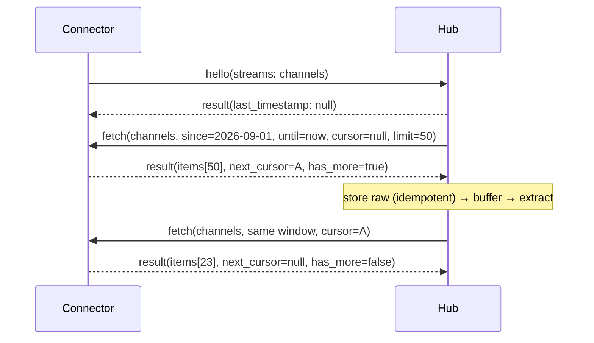
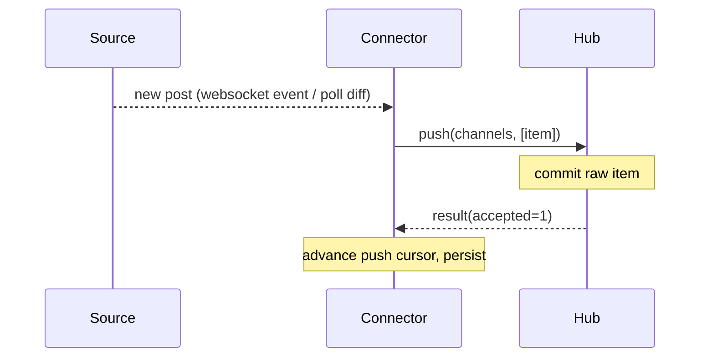
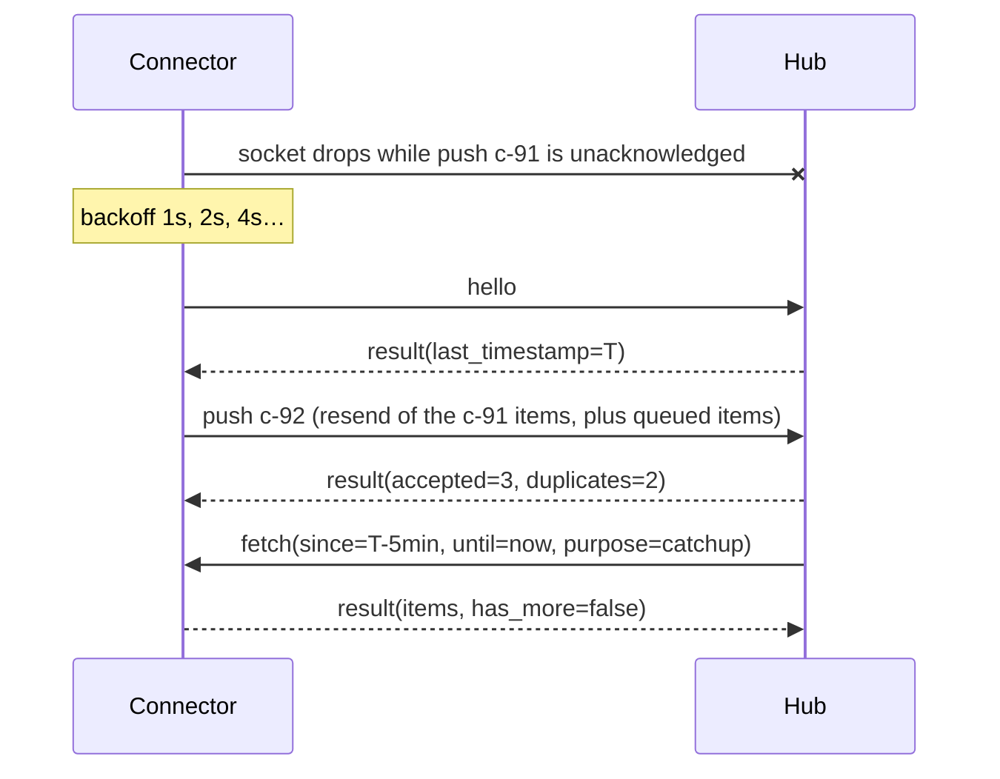
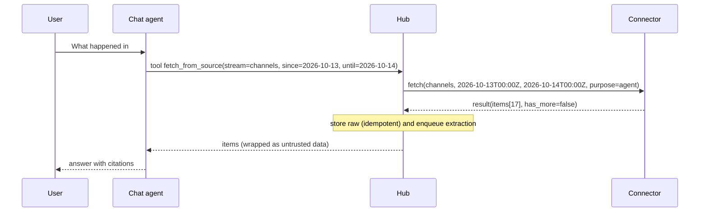

# Mini-Cortex Connector Protocol — v1

The wire contract between a **connector** (an adapter for one data source) and the **hub** (the participant's
mini-cortex app). With this document alone, you should be able to implement a connector in any language.

Status: v1.1 (2026-10-20).

Keywords: **MUST**, **SHOULD** and **MAY** have their usual RFC 2119 meaning. Anything marked **[optional]** can be skipped in the
MVP: the hub keeps working without it.

---

## 1. Overview

```
 source (Mattermost, notes folder, mailbox, …)
      │  native API / files
 ┌────▼──────────┐   WebSocket, JSON-RPC 2.0    ┌──────────────┐
 │  connector    │ ───────── dials in ────────▶ │     hub      │
 │  (adapter)    │ ◀── fetch (hub asks) ─────── │ mini-cortex  │
 │               │ ─── push  (connector tells)▶ │              │
 └───────────────┘                              └──────────────┘
```

The protocol has three ideas:

| Mode | Direction | Use |
|---|---|---|
| `fetch` | hub → connector | Backfill, and "give me what happened in period X" (including from the chat agent) |
| `push` | connector → hub | Live signals: something new or changed just now |
| cursor | both | Resume after a disconnect without losing or re-reading everything |

The connector owns the source credentials and all source-specific logic. The hub never knows what Mattermost or IMAP is.
It only sees `IngestItem`s (§5).

---

## 2. Transport

- **WebSocket**. The connector is the client and the hub is the server. Connectors dial in, so a hub behind a laptop firewall works.
- Endpoint: `ws://127.0.0.1:8765/connectors` (the host and port come from hub config).
- **Auth.** There is a shared local token from the hub's `.env` (`CONNECTOR_TOKEN`).
  - The connector sends it as the header `Authorization: Bearer <token>`.
  - If the WebSocket client cannot set headers, it MAY use `?token=<token>` instead.
  - If the token is wrong, the hub closes the socket with close code **4001**.
- **Framing.** Each WebSocket text frame contains exactly **one** JSON-RPC 2.0 object, UTF-8. JSON-RPC batch arrays are **not** used.
  The maximum frame size is **1 MiB**.
- **Bidirectional JSON-RPC.** Both sides send requests and responses.
  - Request `id`s MUST be strings and unique per sender. Use a prefix so logs are readable: `"c-17"` from the connector, `"h-42"` from the hub.
  - A response always goes back to the side that sent the request.
- **Heartbeat.** Use WebSocket ping/pong frames; most libraries send them automatically (e.g. Python `websockets`: every 20 s, 20 s timeout).
  - If the hub sees no pong for 60 s, it treats the connector as gone.
  - **[optional]** There is also an application-level `ping` method (§4.5), for clients without ping-frame support.

### 2.1 Versioning

- The protocol version is `"1.0"`, using `MAJOR.MINOR`.
- The connector sends `protocol` in `hello`.
- If the hub does not support that major version, it responds with error `-32002` and closes the socket with code **4002**.
- Minor versions only add **[optional]** fields and methods. Both sides MUST ignore unknown fields.

### 2.2 Close codes

| Code | Meaning | Connector should |
|---|---|---|
| 1000 | Normal shutdown | Reconnect only if it is still supposed to run |
| 1001 | Hub restarting | Reconnect with backoff |
| 4001 | Auth failed | Stop and print a clear error (do not retry in a loop) |
| 4002 | Unsupported protocol version | Stop |
| 4003 | Duplicate connector name already connected | Stop (or rename the instance) |
| 4008 | No `hello` within 10 s of connecting | Fix the client |

---

## 3. Lifecycle

```
connect ─▶ hello (connector→hub request) ─▶ hello result ─▶ steady state ─▶ close
                                                 │
                       hub may immediately send fetch (backfill / catch-up)
```

1. The connector opens the WebSocket with its token.
2. The connector sends a **`hello`** request **first**. Until `hello` succeeds, the hub answers any other message with
   `-32008 not_ready`.
3. The hub replies with its session info and the **resume state** for each stream (§3.2).
4. Steady state:
   - the hub sends `fetch` whenever it wants data;
   - the connector sends `push` whenever the source produces something new.
5. On disconnect, the connector reconnects with exponential backoff (1 s, 2 s, 4 s … capped at 30 s, with jitter) and sends `hello` again.

### 3.1 `hello` (connector → hub, request)

```jsonc
{"jsonrpc":"2.0","id":"c-1","method":"hello","params":{
  "protocol": "1.0",
  "connector": "mattermost",                 // unique name per hub; [a-z0-9-]{1,40}
  "display_name": "Acme Mattermost",
  "version": "0.3.0",                        // adapter version, informational
  "streams": [{
    "name": "channels",                      // [a-z0-9_-]{1,40}, unique within connector
    "description": "Messages from public channels the bot can read",
    "kind": "chat",                          // chat | email | note | issue | event | other
    "capabilities": {
      "fetch": true,
      "push": true,
      "time_filter": "native",               // native | emulated (see §4.1.3)
      "earliest": "2026-09-01T00:00:00Z",    // [optional] oldest data available
      "max_limit": 200                       // [optional] largest page the source can serve
    }
  }]
}}
```

`kind` is a hint for the hub's buffering. For example, `chat` items are buffered into windows before extraction, and
`email`/`note` items are extracted one by one.

### 3.2 `hello` result (hub → connector)

```jsonc
{"jsonrpc":"2.0","id":"c-1","result":{
  "protocol": "1.0",
  "session_id": "s-7f3a",
  "hub": "mini-cortex/0.1.0",
  "limits": {"max_frame_bytes": 1048576, "max_items_per_message": 50, "max_content_chars": 200000},
  "streams": {
    "channels": {"accepted": true, "last_timestamp": "2026-10-17T16:40:12Z"}
  }
}}
```

- `last_timestamp` is the newest item `timestamp` the hub has **stored** for that stream, or `null` if it has none. A
  connector without local state can use it to decide what to push after a restart (§7.3).
- If a stream is `"accepted": false`, the hub ignores it. A `reason` field is included.

---

## 4. Methods

| Method | Direction | Type | MVP |
|---|---|---|---|
| `hello` | connector → hub | request | required |
| `fetch` | hub → connector | request | required (if any stream has `fetch: true`) |
| `push` | connector → hub | **request** (acknowledged) | required (if any stream has `push: true`) |
| `ping` | either | request | [optional] |
| `log` | connector → hub | notification | [optional] |

### 4.1 `fetch` (hub → connector, request)

```jsonc
{"jsonrpc":"2.0","id":"h-12","method":"fetch","params":{
  "stream": "channels",
  "since": "2026-10-01T00:00:00Z",   // inclusive
  "until": "2026-10-08T00:00:00Z",   // exclusive
  "cursor": null,                    // null on the first page; then next_cursor from the previous page
  "limit": 50,
  "purpose": "backfill"              // [optional] backfill | catchup | agent — informational only
}}
```

Result:

```jsonc
{"jsonrpc":"2.0","id":"h-12","result":{
  "items": [ /* IngestItem, see §5 */ ],
  "next_cursor": "eyJ0IjoiMjAyNi0xMC0wM1QwOToxMjowMFoiLCJpZCI6Im1tOjk5In0",
  "has_more": true
}}
```

#### 4.1.1 Semantics
- **Time window.** `since` and `until` are UTC RFC 3339 timestamps with a `Z` suffix. The window is half-open: `since ≤ item.timestamp < until`.
  It filters on the item's **event time** (`timestamp`), not on when the adapter saw the item. Both are required, and
  `since < until`; otherwise the connector returns `-32004`.
- **Ordering.** Items MUST be returned in ascending `(timestamp, source_id)` order, across pages too. This makes
  paging deterministic and lets the hub process items in chronological order.
- **`limit`.** At most this many items per page. The default is 50. The connector MAY return fewer, including fewer than `limit` while
  `has_more` is still `true`. It MUST NOT return more. The hub never asks for more than the stream's `max_limit`.
- **Cursor.**
  - It is opaque to the hub; the connector encodes whatever it needs, e.g. base64 JSON of the last `(timestamp, source_id)`.
  - When `cursor` is set, the hub MUST resend the **same** `stream`, `since` and `until` as the first page.
  - A connector that cannot honour an old cursor returns `-32007`, and the hub restarts the window from `cursor: null`. This is safe
    because of idempotency (§7).
- **`has_more`.** `false` means the window is exhausted, and `next_cursor` is then `null`.
- **Empty window.** The result is `{"items": [], "next_cursor": null, "has_more": false}`. This is not an error.

#### 4.1.2 Size limits
- A whole response frame must stay ≤ 1 MiB. If a page would exceed that, the connector returns fewer items and sets `has_more: true`.
- A single item over `max_content_chars` (default 200,000) MUST be split by the connector (§5.3).

#### 4.1.3 Sources without native time filtering
- Set `time_filter: "emulated"` in `hello`. The connector then fetches from the source in whatever way it can (e.g. newest-first
  pages) and filters and sorts in memory before replying.
- It MUST still honour the window, the ordering and the cursor semantics.
- If a window is too expensive, the connector MAY return `-32004` with `data.max_window_seconds`, and the hub splits the window.

#### 4.1.4 `coverage` [optional, 1.1]
- A source with partial history (Slack Free shows 90 days; a cleaned mailbox) adds
  `"coverage": {"since": "<oldest timestamp it can serve>"}` to the fetch result when the requested `since` is older than that.
- The hub passes it on to the chat agent, so "no items" in that range reads as "I can't see that far back", not
  "nothing happened". Hubs that don't know the field ignore it (§2.1).

### 4.2 `push` (connector → hub, request with acknowledgement)

```jsonc
{"jsonrpc":"2.0","id":"c-88","method":"push","params":{
  "stream": "channels",
  "items": [ /* 1..50 IngestItem */ ]
}}
```

Result, sent **only after the items are durably stored** (raw store committed):

```jsonc
{"jsonrpc":"2.0","id":"c-88","result":{"accepted": 2, "duplicates": 1, "updated": 0}}
```

**Why push is a request, not a notification.** A notification gets no reply, so a connector cannot tell "stored" from
"lost in a dropped socket".
- The acknowledgement gives **at-least-once** delivery: the connector advances its own push cursor only after the ack.
  If the ack never arrives (timeout 30 s, disconnect), it resends the same items.
- Resending is safe because the hub deduplicates on `source_id` (§7).
- The counters are informational: `duplicates` means "same `source_id`, nothing changed", and `updated` means "same `source_id`, content changed".

**Backpressure.**
- A connector SHOULD keep at most **one unacknowledged `push` per stream**, and at most 4 across all streams.
- If the hub is overloaded, it answers `-32005` with `data.retry_after_ms`. The connector waits that long and retries the same items.
- New source events that arrive meanwhile are queued locally (in memory is fine for the MVP).

### 4.3 Hub-side processing note (informative)
Items from `fetch` and from `push` go through the **same** intake path: store raw (idempotent on `source_id`), then buffer, then
extract. Items fetched for the chat agent (`purpose: "agent"`) are also stored, so every question improves memory.

### 4.4 `log` [optional] (connector → hub, notification)
`{"jsonrpc":"2.0","method":"log","params":{"level":"warn","message":"Mattermost rate-limited, backing off 5s"}}`
The hub shows these lines in the Sources tab of the UI. This is useful during the workshop.

### 4.5 `ping` [optional] (either direction, request)
`{"jsonrpc":"2.0","id":"h-3","method":"ping","params":{}}` returns `{"jsonrpc":"2.0","id":"h-3","result":{"pong":true}}`.

---

## 5. IngestItem

This extends Cortex's `IngestItem` (`source_connector, source_id, content, timestamp, metadata`). `source_connector` is
implied by the connection; the hub adds it from `hello.connector`.

### 5.1 JSON Schema

```json
{
  "$schema": "https://json-schema.org/draft/2020-12/schema",
  "$id": "mini-cortex/ingest-item/v1",
  "type": "object",
  "required": ["source_id", "content", "timestamp"],
  "additionalProperties": false,
  "properties": {
    "source_id":  {"type": "string", "minLength": 1, "maxLength": 512,
                   "description": "Stable, unique within the connector. See §5.2."},
    "content":    {"type": "string", "minLength": 1,
                   "description": "Plain text or Markdown; the main thing the LLM reads."},
    "timestamp":  {"type": "string", "format": "date-time",
                   "description": "Event time in UTC (sent/posted/created). Used for fetch windows."},
    "updated_at": {"type": "string", "format": "date-time",
                   "description": "Last modification time; set when the item can be edited."},
    "title":      {"type": "string", "maxLength": 300, "description": "Email subject, note title, issue summary."},
    "author":     {"type": "object", "additionalProperties": false, "properties": {
                     "name":  {"type": "string"},
                     "id":    {"type": "string"},
                     "email": {"type": "string"}}},
    "participants": {"type": "array", "items": {"type": "string"},
                     "description": "Recipients / channel members, display names or addresses."},
    "thread_id":  {"type": "string", "description": "Groups related items: email thread, chat channel/thread."},
    "reply_to":   {"type": "string", "description": "source_id of the item this replies to."},
    "url":        {"type": "string", "format": "uri", "description": "Deep link back to the source."},
    "part":       {"type": "object", "required": ["index", "total"], "properties": {
                     "index": {"type": "integer", "minimum": 1},
                     "total": {"type": "integer", "minimum": 1}},
                   "description": "Set only when an oversized item was split (§5.3)."},
    "metadata":   {"type": "object", "description": "Anything source-specific; never interpreted by the hub."}
  }
}
```

The `stream` is taken from the enclosing `fetch`/`push` params, not repeated per item.

### 5.2 `source_id` rules
1. **Stable.** The same real-world object MUST always get the same `source_id`, on every fetch, push and restart.
   This one property makes idempotency, edits and dedup work.
2. **Derive it from the source's native ID.** Recommended form: `<stream>:<native-id>`, e.g. `channels:p9w3k1x8tb`,
   `notes:projects/launch.md`, `inbox:<CAH7x…@mail.example>`. The hub prefixes the connector name, so IDs only need to be unique
   within a connector.
3. **Do not use content hashes**, because an edit would then look like a new item. Use them only if the source truly has no ID.
4. **Renames.** For path-based sources, a rename produces a new `source_id` in the MVP. A note's front matter MAY carry an `id:` that
   survives renames; prefer it when present.

### 5.3 Size and chunking responsibility
- The **connector** splits only items over `max_content_chars` (from the `hello` result, default 200,000 chars).
  - Parts are numbered `<source_id>#p<index>`; each part has `part.index` and `part.total`, and all parts carry the same `timestamp`.
  - Split on paragraph boundaries where possible.
- The **hub** owns all semantic chunking for extraction and embeddings. Connectors MUST NOT pre-chunk normal-sized items.
- Binary attachments are out of scope (§10). A connector MAY include extracted text from an attachment as a separate item
  (`source_id` `…/att/<name>`, with `reply_to` set to the parent).

---

## 6. Errors

JSON-RPC error object: `{"code": <int>, "message": "<short>", "data": {…optional}}`.

| Code | Name | Raised by | `data` | Receiver should |
|---|---|---|---|---|
| -32700 | parse_error | either | — | Log it; fix the sender |
| -32600 | invalid_request | either | — | Log it; fix the sender |
| -32601 | method_not_found | either | `{"method"}` | Treat the feature as unsupported |
| -32602 | invalid_params | either | `{"field","reason"}` | Fix the request (e.g. schema violation in an item) |
| -32603 | internal_error | either | — | Retry later with backoff |
| -32001 | unauthorized | hub | — | (also close 4001) Stop |
| -32002 | unsupported_protocol | hub | `{"supported":["1.0"]}` | Stop |
| -32003 | unknown_stream | either | `{"stream"}` | Hub: drop the request. Connector: fix `hello` |
| -32004 | invalid_range | connector | `{"max_window_seconds"?}` | Hub: fix the window or split it |
| -32005 | rate_limited | either | `{"retry_after_ms"}` | Wait, then retry the **same** request |
| -32006 | source_unavailable | connector | `{"retry_after_ms"?, "detail"}` | Retry later; show it in the UI |
| -32007 | invalid_cursor | connector | — | Restart the window with `cursor: null` |
| -32008 | not_ready | hub | — | Send `hello` first |
| -32009 | capability_unsupported | connector | `{"capability"}` | e.g. `fetch` on a push-only stream; do not retry |

For `push`, schema validation is per item.
- If some items are invalid, the hub stores the valid ones and returns a **result** (not an error) with
  `"rejected": [{"source_id": "…", "reason": "…"}]`. The connector must not resend rejected items unchanged.
- The hub returns an error only if nothing in the batch could be processed.

---

## 7. Delivery guarantees and idempotency

| Property | Guarantee |
|---|---|
| Delivery | **At least once**, for both fetch and push. Duplicates are expected and harmless |
| Idempotency key | `(connector, source_id)`, enforced by the hub's raw store |
| Same `source_id`, same content | No-op (`duplicates`++) |
| Same `source_id`, different content or newer `updated_at` | **Update**: the raw item is replaced, re-extracted, and packets are merged through normal dedup (`updated`++) |
| Ordering | Fetch: ascending `(timestamp, source_id)` within a window. Push: best effort; the hub must not depend on push order |
| Durability | A push ack means the item is in the raw store. A fetch result is durable once the hub has stored it; a lost page is simply re-fetched |

### 7.1 Who owns which cursor
- The **hub** owns backfill progress: per stream, it records the last completed window and the in-flight `next_cursor`. It persists these in
  SQLite and resumes after a restart.
- The **connector** owns its **push cursor**: its position in the source's change feed (last seen post ID, mtime, IMAP UID…).
  - It advances this cursor only after the push is acknowledged.
  - It SHOULD persist the cursor locally (a small JSON file is fine).

### 7.2 Gap repair (catch-up)
After a connector reconnects, the hub MAY issue `fetch(since = last_timestamp - 5 min, until = now, purpose = "catchup")`.
The overlap is deliberate (the same idea as Cortex's overlap windows); duplicates are free. With catch-up, a connector that
lost its push cursor still converges.

### 7.3 Connector without local state
On start, the connector uses `hello` result `streams.<name>.last_timestamp` as its push cursor, and pushes only items newer than that.
Items it missed are covered by the hub's catch-up fetch.

---

## 8. Sequence diagrams

### 8.1 Initial backfill


### 8.2 Live push


### 8.3 Reconnect with cursor


### 8.4 Agent-initiated fetch ("What happened last Tuesday?")

The agent tool resolves "last Tuesday" to concrete UTC bounds *before* calling. The protocol only ever sees absolute timestamps.

---

## 9. Example transcripts

`→` means connector to hub, and `←` means hub to connector.

### 9.1 Mattermost-like chat source
```jsonc
→ {"jsonrpc":"2.0","id":"c-1","method":"hello","params":{"protocol":"1.0","connector":"mattermost",
   "streams":[{"name":"channels","kind":"chat","capabilities":{"fetch":true,"push":true,"time_filter":"native","max_limit":200}}]}}
← {"jsonrpc":"2.0","id":"c-1","result":{"protocol":"1.0","session_id":"s-01","hub":"mini-cortex/0.1.0",
   "limits":{"max_frame_bytes":1048576,"max_items_per_message":50,"max_content_chars":200000},
   "streams":{"channels":{"accepted":true,"last_timestamp":null}}}}
← {"jsonrpc":"2.0","id":"h-1","method":"fetch","params":{"stream":"channels",
   "since":"2026-10-01T00:00:00Z","until":"2026-10-18T12:00:00Z","cursor":null,"limit":2,"purpose":"backfill"}}
→ {"jsonrpc":"2.0","id":"h-1","result":{"has_more":true,"next_cursor":"MjAyNi0xMC0wMlQwOTowNTowMFp8cDI=","items":[
   {"source_id":"channels:p1","timestamp":"2026-10-02T09:01:00Z","content":"Do we ship the beta on Oct 20 or Oct 27?",
    "author":{"name":"Maya Chen","id":"u7"},"thread_id":"launch","url":"https://chat.example/acme/pl/p1"},
   {"source_id":"channels:p2","timestamp":"2026-10-02T09:05:00Z","content":"Oct 27 — QA needs the extra week.",
    "author":{"name":"Tom Ruiz","id":"u3"},"thread_id":"launch","reply_to":"channels:p1",
    "url":"https://chat.example/acme/pl/p2"}]}}
← {"jsonrpc":"2.0","id":"h-2","method":"fetch","params":{"stream":"channels",
   "since":"2026-10-01T00:00:00Z","until":"2026-10-18T12:00:00Z","cursor":"MjAyNi0xMC0wMlQwOTowNTowMFp8cDI=","limit":2}}
→ {"jsonrpc":"2.0","id":"h-2","result":{"items":[],"next_cursor":null,"has_more":false}}
→ {"jsonrpc":"2.0","id":"c-2","method":"push","params":{"stream":"channels","items":[
   {"source_id":"channels:p3","timestamp":"2026-10-18T12:03:10Z","content":"Heads-up: payment provider sandbox is down until 3pm.",
    "author":{"name":"Workshop participant","id":"u42"},"thread_id":"live"}]}}
← {"jsonrpc":"2.0","id":"c-2","result":{"accepted":1,"duplicates":0,"updated":0}}
```

### 9.2 Notes-folder source (edit = re-send with the same `source_id`)
```jsonc
→ {"jsonrpc":"2.0","id":"c-1","method":"hello","params":{"protocol":"1.0","connector":"notes",
   "streams":[{"name":"notes","kind":"note","capabilities":{"fetch":true,"push":true,"time_filter":"emulated"}}]}}
← {"jsonrpc":"2.0","id":"c-1","result":{"protocol":"1.0","session_id":"s-02","hub":"mini-cortex/0.1.0",
   "limits":{"max_frame_bytes":1048576,"max_items_per_message":50,"max_content_chars":200000},
   "streams":{"notes":{"accepted":true,"last_timestamp":"2026-10-15T20:11:00Z"}}}}
// The user edits a file. The watcher fires; the connector pushes the full new content under the same source_id.
→ {"jsonrpc":"2.0","id":"c-2","method":"push","params":{"stream":"notes","items":[
   {"source_id":"notes:trips/lisbon.md","timestamp":"2026-10-10T18:00:00Z","updated_at":"2026-10-18T12:10:44Z",
    "title":"Lisbon trip","content":"# Lisbon trip\nFlights booked: Nov 14–18. Hotel: Alfama, prefers a quiet room."}]}}
← {"jsonrpc":"2.0","id":"c-2","result":{"accepted":0,"duplicates":0,"updated":1}}
```
`timestamp` stays the note's creation time, so the note keeps its place in time windows. `updated_at` signals the edit.

---

## 10. Adapter author checklist

1. **Authenticate** to the source. Credentials live only in the adapter's config or env and never cross the wire.
2. **Map** each native object to an `IngestItem` with a **stable `source_id`** (§5.2) and a UTC event `timestamp`.
3. **Answer `fetch`** for `[since, until)`, sorted ascending, paged with an opaque cursor: natively, or emulated (§4.1.3).
4. **Emit `push`** for new or changed items, from a source event feed or by polling and diffing. Advance and persist the push cursor
   only after the ack.

Plus:
- send `hello` first;
- reconnect with backoff;
- keep at most one unacknowledged push per stream;
- honour `retry_after_ms`;
- split items only over `max_content_chars`.

### 10.1 Python skeleton (pseudo-code)

```python
import asyncio, json, itertools, websockets

HUB, TOKEN = "ws://127.0.0.1:8765/connectors", "dev-token"
ids = (f"c-{n}" for n in itertools.count(1))
pending: dict[str, asyncio.Future] = {}

async def call(ws, method, params):                     # request → awaits the matching response
    rid = next(ids); fut = pending[rid] = asyncio.get_running_loop().create_future()
    await ws.send(json.dumps({"jsonrpc": "2.0", "id": rid, "method": method, "params": params}))
    return await asyncio.wait_for(fut, 30)

async def handle_fetch(p):                              # duty 3
    items, nxt = await source.query(p["since"], p["until"], p["cursor"], p["limit"])  # sorted asc
    return {"items": [to_item(x) for x in items], "next_cursor": nxt, "has_more": nxt is not None}

def to_item(x):                                         # duty 2
    return {"source_id": f"channels:{x.id}", "timestamp": x.created_utc, "content": x.text,
            "author": {"name": x.user}, "thread_id": x.channel}

async def reader(ws):
    async for raw in ws:
        msg = json.loads(raw)
        if "method" in msg and msg["method"] == "fetch":
            try:    reply = {"result": await handle_fetch(msg["params"])}
            except SourceDown: reply = {"error": {"code": -32006, "message": "source_unavailable"}}
            await ws.send(json.dumps({"jsonrpc": "2.0", "id": msg["id"], **reply}))
        elif "id" in msg and msg["id"] in pending:      # a response to one of our requests
            pending.pop(msg["id"]).set_result(msg)

async def pusher(ws):                                   # duty 4
    async for batch in source.watch(since=state.push_cursor):   # yields new/changed objects
        resp = await call(ws, "push", {"stream": "channels", "items": [to_item(x) for x in batch]})
        if "result" in resp: state.save(push_cursor=batch[-1].id)  # advance only after ack

async def main():
    await source.login()                                # duty 1
    async for ws in websockets.connect(HUB, additional_headers={"Authorization": f"Bearer {TOKEN}"}):
        try:
            await asyncio.gather(reader(ws), hello_then(ws, pusher))  # hello first, then push loop
        except websockets.ConnectionClosed:
            continue                                    # the library reconnects with backoff
```

`hello_then` sends `hello` via `call()` (the reader must already be running to receive its result), then starts `pusher`.
The workshop repo ships a real `connector_sdk.py` that hides all of this. Participants only implement `to_item`, `query` and
`watch`.

---

## 11. Out of scope for v1 / future

- **Deletes.** They are not propagated in v1; a deleted source object stays in memory. Future work: a `retract` method with `source_id`s.
- **Edits.** These *are* handled: re-send the same `source_id` with new content (ideally with `updated_at`). The hub updates the raw item and
  re-extracts it.
- **Binary attachments.** Only extracted text, sent as separate items (§5.3). No blobs on the wire.
- **Multi-user hub, per-connector tokens, TLS.** v1 is localhost and single user. For remote hubs, use `wss://` with per-connector tokens.
- **Hub → connector subscriptions or filters** (e.g. "only push channel X"): connector config for now.
- **Streaming large fetches** (server-push pages): plain request/response paging is enough at workshop scale.
- **MCP.** MCP is for exposing *tools and resources to an LLM client*, on demand. This protocol is for *ingesting streams into memory*.
  They are complementary: mini-cortex could later expose its memory via MCP (like full Cortex does), and an MCP server
  could be wrapped by an adapter. MCP does not replace this protocol.
